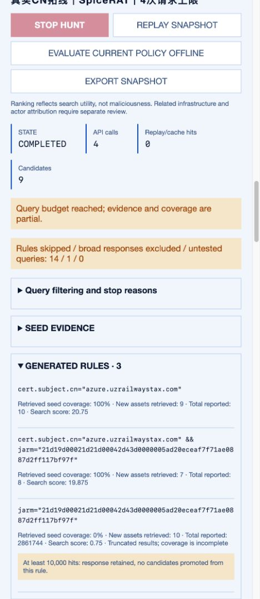
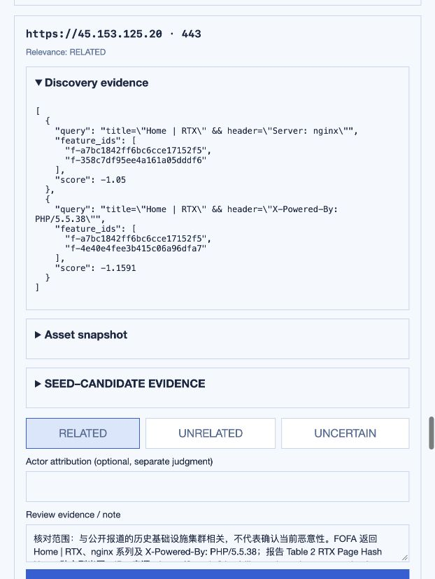

<h1 align="center">Z-Hound</h1>

<p align="center">
  <strong>高价值 IoC 拓线与证据研判，让每一条关联有据可查。</strong><br>
  Hunt from trusted IoCs. Investigate the evidence.
</p>

<p align="center">
  <a href="https://www.python.org/downloads/"></a>
  <a href="LICENSE"></a>
  <a href="docs/dashboard.md"></a>
</p>

<p align="center">
  <a href="#快速开始">快速开始</a> ·
  <a href="#怎么用">使用流程</a> ·
  <a href="docs/hunting.md">拓线与研判</a> ·
  <a href="https://github.com/yyzpiero/Z-Hound/issues">反馈问题</a>
</p>

Z-Hound 是面向威胁情报分析人员的**资产拓线与证据研判工作台**，同时集成 **Z-Hunter 报告采集模块**，提供两条工作流：

| 工作流 | 起点与用途 |
| --- | --- |
| **已有高价值 IoC → 拓线与研判** | 以人工确认的种子为起点，结合 FOFA 返回的 JARM、证书、服务等信息孵化关联资产，再逐项研判证据。 |
| **Z-Hunter → 报告与 IoC 采集** | 从公开报告中抓取、提取和审核 IoC，积累带来源的情报；其中经过人工确认且有分析价值的指标可以成为拓线种子。 |

**采集是补充情报的一条路径，不是拓线的业务前提。** 独立种子库支持直接粘贴或导入已有 IoC，并分别记录人工确认、价值判断和来源依据。

真实拓线使用你自己的 FOFA API；DeepSeek 可选，用于排序已观测特征。报告采集与本地审核无需这两个 API。

## 能做什么

| 功能 | 帮你完成什么 |
| --- | --- |
| **独立种子库** | 粘贴或导入 TXT / CSV / JSON；记录来源、确认依据、分析人员和价值评级，支持撤销确认与变更追溯。 |
| **资产拓线** | 围绕人工选定的种子，利用 FOFA 返回的 JARM、证书、标题、服务等已观测特征生成组合查询，发现候选资产。 |
| **证据研判** | 逐项对照种子与候选特征，区分匹配、差异和缺失证据；记录关联性、研判依据及独立的组织归属判断。 |
| **Z-Hunter 采集** | 从安全厂商博客、RSS、站点地图及公开微信公众号文章中发现报告；需要时使用浏览器加载页面。 |
| **IoC 提取与审核** | 提取 IP、域名、URL 和文件哈希；将待确认项送入审核队列，结合原文接受或拒绝。 |
| **证据留存** | 保留来源报告、采集批次、页面缓存与审核记录，输出本地 CSV 和运行快照。 |
| **可选 LLM 辅助** | 使用 DeepSeek 结合报告与资产上下文，对已观测特征排序；失败时回退到固定规则。 |
| **离线回放** | 导出、导入并重放拓线快照，复查查询过程与候选证据，无需再次调用 API。 |

Dashboard 支持中英文、深浅主题；CLI 适合批量采集和脚本调用。

## 快速开始

当前拓线代码尚未合并到公开默认分支，v0.3.0 也尚未发布；试用请使用包含本次改动的源码包。

安装 **Docker Engine / Docker Desktop（含 Compose v2）**，下载本版源码并进入项目目录。首次运行：

```bash
cp .env.example .env
```

打开 `.env`，填入自己的官方 API Key：

```dotenv
FOFA_BASE_URL=https://fofa.info
FOFA_API_KEY=你的FOFA_API_Key
# 邮箱为旧账号兼容选项，可留空
FOFA_EMAIL=
# 可选，不填也能拓线
DEEPSEEK_API_KEY=
DEEPSEEK_MODEL=deepseek-flash
```

保存后启动（macOS / Linux）：

```bash
cp -n data/source.example.csv data/source.csv
env UID="$(id -u)" GID="$(id -g)" docker compose up --build -d
docker compose ps
```

Windows Docker Desktop 在 PowerShell 中先用 `Copy-Item .env.example .env` 复制配置，再编辑并运行 `docker compose up --build -d`。报告源模板可用 `Copy-Item data/source.example.csv data/source.csv` 复制，已有文件请保留。

打开 **[http://127.0.0.1:8080/#/hunting](http://127.0.0.1:8080/#/hunting)**，在独立种子库导入自己的 IoC，确认来源并标为高价值，再新建 FOFA 拓线。第一次建议 **1 个种子、最多 4 次请求、每次最多 10 条结果**。

全新安装的种子库和任务列表为空。程序使用真实 API 获取资产，离线样例需要手动运行；本仓库的研究快照不会自动导入。数据保存在 `./data/`，`docker compose down` 后仍保留，包括种子、审核和拓线记录。

修改 `.env` 后执行 `docker compose up -d --force-recreate dashboard`。查看日志用 `docker compose logs --tail=100 dashboard`。界面的“已配置”表示服务端收到 Key，账户权限和额度要由首次真实查询验证。

<details>
<summary><strong>直接用 Python 运行</strong></summary>

需要 Python 3.11+，在源码目录运行：

```bash
python3 -m venv .venv
source .venv/bin/activate
pip install -e '.[dashboard]'
python -m playwright install chromium
set -a
. ./.env
set +a
ioc-scraper dashboard --host 127.0.0.1 --port 8080
```

</details>

<details>
<summary><strong>无 Key 试用、离线回放与镜像交付</strong></summary>

“运行离线演示”使用合成资产，供检查操作流程。也可下载[真实 CN 案例快照](docs/cases/certificate-cn-2026-10-27.json)，通过“导入回放快照”复查实际查询和研判；两种操作均不消耗 API。自己的实时查询结果会随供应商数据更新而变化。

镜像构建、验证、导出和跨机器交付见[部署参考](docs/usage.md#docker)。当前拓线代码位于 `codex/hunter-integration`，尚未合并到公开默认分支，也尚未发布 v0.3.0 标签；发布前请使用包含本次代码的源码包。普通克隆公开默认分支不会自动获得这些未合并改动。

</details>

Dashboard 面向本机使用，Compose 只发布到 `127.0.0.1:8080`。

## 怎么用

### 1. 已有高价值 IoC：拓线与证据研判

1. **导入与确认**：在「资产拓线 → 独立种子库」粘贴或导入 IP、域名或 URL。点击「确认／更新」，填写来源、原始证据、人员标识和本次理由，选择「已确认」「高价值」。可参考 [CSV 模板](ioc_scraper/dashboard/static/seed-template.csv)。
2. **孵化线索**：在「新建 FOFA 拓线」选择已具备资格的种子，设置请求预算与结果上限；从 FOFA 的资产信息中提取 JARM 等特征，组合查询关联资产。
3. **研判证据**：对照种子与候选的特征、命中规则、服务信息，记录相关 / 无关 / 待定及依据，单独判断组织归属。
4. **保存与复核**：导出查询、资产和审核快照，离线回放分析过程；点击「用当前策略离线评估」可用新过滤策略重新检查旧响应，不消耗 API。

每次最多导入 500 行、2 MiB。导入后默认为待确认、未评级；只有**已确认＋高价值＋完整来源依据**的种子可启动真实拓线。撤销确认或降低价值会阻止新任务，历史任务中的种子证据保持不变。

### 2. Z-Hunter：抓取与积累 IoC

1. 在 `data/source.csv` 配置情报源，通过「采集控制台」或 CLI 抓取公开报告。
2. 在「人工审核」结合原文处理待确认项；规则自动收录与人工接受的指标保存于 `data/indicators.csv`，保留报告与批次信息。
3. 需要拓线时，在独立种子库的「从 Z-Hunter 转入」中选择采集指标，再单独确认种子与价值。**采集库的 `accepted` 可能来自自动收录，不等于人工确认。**

### 真实案例：从证书 CN 找回关联基础设施

2026-10-27，用 `188.190.29[.]126:443` 作为唯一种子，新版引擎从 FOFA 实际响应中提取 `azure.uzrailwaystax[.]com`，自动执行 CN 查询和 CN＋JARM 组合查询。

| 实际消耗 | 结果与核对 |
| --- | --- |
| **4 次 FOFA 搜索，29 行响应，0 次 DS** | 得到 9 个候选服务、7 个未作为输入的 IP |
| 逐项比对证书、序列号、签发机构与服务信息 | 全部候选的完整证书文本与种子一致；其中 6 个 IP 在[原始研究](https://hunt.io/blog/silkparasite-spicerat-central-asia-infrastructure)中有历史关联依据 |
| 处理证据不足和海量命中 | 1 个 IP 保持待定；通用 JARM 的海量结果被拦截，没有形成候选 |

这次比此前的标题拓线多找回了 **5 个有公开来源佐证的关联 IP**。这里的“找回”指未作为本次输入的历史基础设施，当前恶意性仍需结合业务证据判断。[查看完整查询、候选清单与可回放证据](docs/cases/certificate-cn-2026-10-27.md)。



<sub>本轮真实任务截图。关联性由 Codex 辅助核对，组织归属留空；资产观测时间未由供应商提供。</sub>

### 真实案例：从一个种子找回 6 个已报道关联 IP

2026-10-27，使用 FOFA 兼容服务，以 [Hunt.io SpiceRAT 研究](https://hunt.io/blog/silkparasite-spicerat-central-asia-infrastructure)中的 `188.190.29[.]126:80` 为唯一输入，运行未修改的拓线引擎：

| 输入 → 处理 → 核对 | 实际结果 |
| --- | --- |
| 1 个种子服务 → 提取标题和响应头 → 自动组合查询 | 4 次搜索，返回 31 行，去重得到 16 个候选服务 |
| 对照公开报告，排除种子自身和同名站点 | 找回 **6 个未作为输入的已报道关联 IP**；RTX 官网的 3 个候选服务被排除 |
| 保存证据与研判 → 离线回放 | 规则、候选与研判结果一致，回放新增 API 调用为 0 |

这是一次**已知基础设施的真实拓线复现**，不代表发现 6 个新恶意 IoC。成功任务未启用 DeepSeek；包含前两次未成功试跑和一次证书查询，整轮共用 12 次 FOFA、2 次 DeepSeek。其余证据不足的候选保持待定。详见[查询、证据链、完整消耗与局限](docs/cases/spicerat-2026-10-27.md)。



<sub>本地真实任务截图。研判由 Codex 辅助核对公开来源，组织归属留空；未主动访问可疑目标，资产观测时间未知。</sub>

### 接入 FOFA / DeepSeek

| 使用场景 | 所需配置 |
| --- | --- |
| 公开报告采集、IoC 审核、离线演示与回放 | 无需 API Key |
| FOFA 真实资产查询 | `FOFA_API_KEY`，以及可用额度 / 权限；`FOFA_EMAIL` 可选 |
| DeepSeek 辅助特征排序 | `DEEPSEEK_API_KEY`；可用 `DEEPSEEK_MODEL` 指定模型 |

参考 [`.env.example`](.env.example) 配置。Docker Compose 读取根目录 `.env`；本地 Python 启动需先将变量导入环境，再重启 Dashboard。启用 DeepSeek 会向该服务发送选定的报告和资产证据。具体步骤见[拓线配置指南](docs/hunting.md#configure-providers-later)。

新任务会跳过仅由停放页、Cloudflare/Akamai 错误页、通用服务或共享托管指纹构成的规则。证书会拆分主体名称、签发机构、序列号与有效期供逐项研判；有辨识度的主体名称可用于拓线，通用证书名和仅见于错误页的证书会降权。单条拓线规则命中至少 10,000 条时保留原始响应，但不产生候选；连续两条触发后提前停止。界面可展开查看跳过与停止原因，更窄的未执行规则仍可能有价值。

拓线使用真实 API，但关联结果仍需要分析人员审核。JARM 来自 FOFA 返回值，未实现主动 JARM 探测；指纹相同只是关联线索。已完成[小规模真实接口验证](docs/reviews/2026-10-27-live-provider-trial.md)和[真实快照离线过滤对比](docs/reviews/2026-10-27-noise-policy.md)，新增的[错误页过滤与证书提取验证](docs/reviews/2026-10-27-cdn-certificate.md)保留了真实案例的全部 16 个候选服务；整体准确率与召回率尚未测量。候选不会自动写入正式 IoC 库，当前也未实现自动归因或强化学习训练。

### Z-Hunter 常用 CLI

采集模块统一称为 Z-Hunter；现有命令名保留 `ioc-scraper`。

```bash
ioc-scraper                                  # 交互菜单
ioc-scraper list-sources                     # 查看来源
ioc-scraper collect --lookback 3m             # 采集近三个月报告
ioc-scraper collect --source 18 24 --lookback 3m
ioc-scraper validate-sources --max-pages 2 --max-reports 20
```

来源 ID 以自己的 `data/source.csv` 为准。详细筛选、代理、输出文件与访问受限处理见[使用参考](docs/usage.md)。

## 文档与参与

- [使用与部署](docs/usage.md) — CLI 参数、数据文件、采集边界、Docker 交付。
- [Dashboard](docs/dashboard.md) — 控制台操作与本地运行说明。
- [拓线与证据研判](docs/hunting.md) — API 配置、种子要求、快照回放与当前限制。
- [提交 Issue](https://github.com/yyzpiero/Z-Hound/issues) / [Pull Request](https://github.com/yyzpiero/Z-Hound/pulls) — 欢迎补充来源适配、反馈提取问题与改进使用体验；请使用脱敏样例。

本项目采用 [MIT License](LICENSE)。
